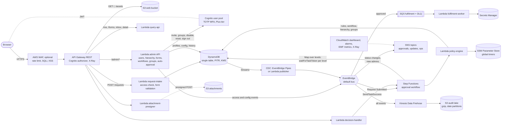

# Request Hub: a cloud-native request and approval platform on AWS

An industry-agnostic, event-driven platform for anything that needs a "yes" before it happens: purchases, access, leave, production changes, or a general request. Admins design each module's form, its approval levels and the org hierarchy in the web app. Every request follows the requester's reporting line and the approver groups its value calls for, escalates when an SLA is missed, and is fulfilled automatically once approved, with a full audit trail. Nothing is auto-approved unless an admin grants a person auto-approval, up to a limit and until a date.

It is built to run inside the **KodeKloud AWS Playground** (3-hour sessions, us-east-1), so every design choice respects its limits. One command deploys it from AWS CloudShell.

## Architecture



### The flow, in one paragraph

A signed-in user picks a module and fills in that module's form. The **request-intake** Lambda checks their live access profile (account active, module granted) and validates every field against the module's current form version, then stores the request with a snapshot of the fields. DynamoDB Streams feeds **EventBridge Pipes** (or, where Pipes is blocked, a small batched Lambda), which turns the change into a `Request Submitted` event and starts a **Step Functions** workflow with the request ID as an idempotent execution name. The **policy engine** auto-approves only under an admin-granted rule; otherwise it builds an **approval plan**: level 1 is the requester's line manager, then any approver groups (Finance, a change board) whose threshold the request's value reaches, with admins standing in wherever nobody is eligible. A sequential **Map state** walks the levels: each one names its approvers on the request and pauses on a task token (**AWS SDK integration with `.waitForTaskToken`**). When a named approver decides, a Lambda checks they are on that level, are not the requester and did not approve an earlier level, then calls `SendTaskSuccess`. A missed SLA escalates the level to admins, and a second miss expires the request. Each decision is a child item; each status or level change is an event that EventBridge routes to SNS (notifications), SQS (fulfilment) and Firehose (audit lake).

## Forms, approval workflows and the org hierarchy

Admins configure everything below from the **Admin** area of the web app; nothing needs a redeploy.

**Forms (per module, versioned).** A form builder adds, reorders and removes fields (short text, long text, number, money amount, date, dropdown, checkbox), marks them required, adds help text and limits, and picks the **approval value** field that drives thresholds. A requester only sees the fields of the module they choose, along with a live preview of the approval route for the value they type. Saving creates a new version; each request keeps the version and field labels it was submitted with, and the server validates every submission against that version.

**Org hierarchy.** Each user has a manager, a department and a job title, set on their user page or in bulk with a CSV import that is checked first (unknown people, managers who are not approvers, loops across rows). Only active Approvers and Admins can manage people, loops are refused, and an org chart shows the tree.

**Approval workflows (per module).** Level 1 is always the requester's **line manager**, so an approver's own request goes to their manager like everyone else's. Later levels are **approver groups** or **admins**, each switched on by a threshold on the approval value (for example Finance from 1,000 and admins from 10,000), up to five levels, with an SLA per level and an escalation timer. The rules every chain follows:

* Nobody approves their own request, and the same person cannot approve two levels of one request.
* If a level has nobody eligible (no manager, an empty group, disabled people), admins stand in; if not even an admin is eligible, the request stops as UNROUTABLE instead of waiting forever.
* Admins cannot jump the chain: they decide only levels that name them (admin levels, stand-ins and escalations).
* A plan is fixed when the request is submitted, so configuration changes never alter requests already in flight.

**Auto-approval (off by default).** An admin can grant one person auto-approval for one module, up to a limit and until an expiry date (at most a year). Nobody can grant it to themselves; every grant and revocation is in the person's history and published as an event. Without a matching, unexpired rule, every request goes through its chain.

## User management and module access

Admins manage people from **Admin > Users**: invite someone, choose their role, tick the modules they may use, set their manager, and later change, disable, reset or delete them. Everything an admin does is recorded in the user's access history.

| Role | Can do |
| --- | --- |
| Requester | Raise and track requests in the modules they hold |
| Approver | The same, and can manage people (be a line manager) and sit in approver groups |
| Admin | Manage users and configuration, stand in where nobody else can approve, handle escalations; every module is included |

**Modules** (Purchasing, Access management, Leave, Change management, General requests) decide what a person can raise. Who approves comes from the chain: a manager approves their reports' requests in any module.

**Where it is enforced.** Identity (password, MFA, sign-in) stays in Cognito. Authorisation lives in a `PROFILE` item per user in DynamoDB (role, modules, manager, status), and every path reads that live item, so a grant, a revocation or a disabled account applies on the user's next click instead of when their one-hour token expires: intake (module and status), the inbox and decisions (named on the current level), attachments, and the admin API (an active admin, read from the profile rather than the token).

**Admin actions:** invite (with or without the email), change name, role, modules and reporting line (optimistic locking, so two admins cannot overwrite each other), disable and enable, reset password, resend the invitation, reset a lost authenticator, sign out everywhere, and delete (requests and history are kept).

**Guardrails:** admins cannot disable, delete or demote themselves; the last active admin cannot be removed; someone with direct reports or approver group seats cannot be demoted or deleted until those are reassigned; and every change is one transaction with its history item. An EventBridge rule emails the ops topic whenever someone is made an admin. The admin Lambda's IAM policy is scoped to `USER#` and `CONFIG` items with `dynamodb:LeadingKeys`, so it cannot touch requests.

## AWS services used

| Area | Services |
| --- | --- |
| Edge and identity | Amazon API Gateway (REST), Amazon Cognito (Plus tier, TOTP MFA), AWS WAF (when the account allows it) |
| Compute and orchestration | AWS Lambda (7 or 8 small functions), AWS Step Functions (Standard, SDK integration with task tokens) |
| Events and messaging | Amazon EventBridge (rules on the default bus), EventBridge Pipes (when allowed), Amazon SQS (queue + 2 DLQs), Amazon SNS (3 topics, email) |
| Data | Amazon DynamoDB (single table, Streams, PITR, 2 GSIs), Amazon S3 (web, attachments, audit lake), Amazon Data Firehose |
| Security and config | AWS KMS (customer managed key), AWS Secrets Manager, AWS Systems Manager Parameter Store, AWS IAM |
| Observability | Amazon CloudWatch (dashboard, 6 alarms, embedded-metric-format KPIs, logs), AWS X-Ray |
| Delivery | AWS CloudFormation (packaged by the AWS SAM CLI), AWS CodePipeline (V2), AWS CodeBuild, AWS CloudShell |
| Governance (optional stack) | AWS CloudTrail, AWS Config managed rules |

## Designed around the playground limits

Everything below was found by deploying into a live KodeKloud AWS Playground session (November 2026), probing with the AWS CLI and reading the playground's own IAM policies. Several restrictions are not on the playground's published list.

| Playground restriction | How the project handles it |
| --- | --- |
| A Lambda function invoked more than 300 times in an hour is deleted; max 256 MB and 10 s | Lambda only where code adds value: create, routing, notifications, queueing and auditing are functionless. 256 MB and 8 s everywhere. An alarm fires at 200 invocations per function per hour. The smoke test waits on DynamoDB, not the API. |
| `iam:PutRolePolicy` is denied; `iam:PassRole` works only for roles under `/service-role/` | Every role is explicit, lives under `/service-role/` and uses customer managed policies. No SAM-generated roles. |
| Tagging is denied for several services (for example `events:TagResource`) | No stack or resource tags, and plain CloudFormation resources instead of SAM resources (SAM tags functions and state machines automatically). |
| Custom event buses and archives are denied | Rules live on the default event bus; there is no event archive. |
| AWS WAF and EventBridge Pipes are blocked by a service control policy (the published list includes WAF) | `deploy.sh` probes both and falls back automatically: no web ACL (API Gateway throttling and schema validation remain), and a batched Lambda publisher instead of Pipes. |
| KMS rotation and key deletion, log retention, and deletes of log groups, parameters, secrets, alarms and managed policies are denied | Those resources are retained on delete and get per-deployment unique names, so a redeploy never collides with leftovers. |
| `secretsmanager:GetRandomPassword` is denied | `deploy.sh` generates the downstream API key with `openssl` and passes it as a NoEcho parameter. |
| The console user cannot read Secrets Manager values | Test-user credentials for the scripts live in a mode-600 file in the CloudShell home directory (use Secrets Manager in a real account). |
| Logs Insights saved queries are denied | None are created. |
| No CloudFront; App Runner closed to new customers (April 2026) | The single-page app is served over HTTPS by API Gateway from a private S3 bucket, on the same origin as the API. |
| Firehose buffer max 5 MB, interval min 60 s | 1 MB / 60 s, gzip, timestamp-based date prefixes. |
| CodeBuild small compute and 10-minute builds, 3 pipelines, 5 runs per hour | Small compute, 10-minute timeout, one pipeline; `release.sh` refuses a 5th run in an hour. |
| The playground's compliance checker (`ConfigRuleCheckerSession`, seen in CloudTrail) deletes EventBridge rules whose target is a Step Functions state machine | In Lambda-publisher mode the CDC Lambda starts the workflow itself, with the request ID as the execution name so a redelivered stream record cannot start it twice. The rule-based start is kept for Pipes mode, and `verify-rules.sh` checks every rule after a deploy. |
| Sessions last 3 hours, then the account is wiped | Everything is code: `preflight.sh`, `permissions-check.py`, then one `deploy.sh`. |

`python3 scripts/permissions-check.py` runs IAM's policy simulator over every action the stacks need (with the time-window context the playground's policies require), which finds most of the above in seconds.

## Deploy (AWS CloudShell, us-east-1)

```bash
git clone https://github.com/bamboomaster112/aws-request-hub.git
cd aws-request-hub
./scripts/preflight.sh                 # read-only permission probe, about 20 seconds
python3 scripts/permissions-check.py   # IAM policy simulator over every action the stacks need
./scripts/deploy.sh                    # core stack + default forms, workflows, groups + web app + CI/CD
python3 scripts/seed-users.py          # requester -> approver -> admin test users with MFA enrolled
python3 scripts/smoke-test.py          # end-to-end checks
```

Options for `deploy.sh`:

| Variable | Default | Effect |
| --- | --- | --- |
| `NOTIFICATION_EMAIL` | empty | Subscribes an email address to the approvals, updates and ops topics |
| `USE_PIPES` | `true` | `false` swaps EventBridge Pipes for a small Lambda CDC publisher (switched automatically when Pipes is blocked) |
| `ENABLE_WAF` | `auto` | `true` / `false` forces the WAF web ACL on or off; `auto` turns it off when WAF is blocked |
| `SLA_SECONDS` | `180` | Approval and escalation timers (short for demos) |
| `WITH_PIPELINE` | `true` | Deploys the CodePipeline/CodeBuild stack |
| `WITH_GOVERNANCE` | `false` | Deploys CloudTrail and AWS Config rules |

`deploy.sh` runs `scripts/seed-config.py`, which writes starting forms, workflows and approver groups only where none exist, so it never overwrites an admin's changes. To use the web app yourself, bootstrap the first admin from CloudShell and follow the emailed temporary password. After that, invite everyone else, set their managers and add approver group members from the **Admin** area:

```bash
./scripts/create-user.sh you@yourdomain.com admins
./scripts/create-user.sh ana@yourdomain.com approvers PURCHASE,ACCESS   # optional: more users from the CLI
```

## Demo script

Set up first, as an admin: give a requester a manager (an Approver), put someone in the Finance group, and look at **Admin > Workflows > Purchasing** (line manager, Finance from 1,000, admins from 10,000).

1. **Dynamic forms.** Open **New request** and switch modules: each shows only its own fields, and the approval route updates as you type the value.
2. **No default auto-approval.** Raise a Purchasing request for 250. It waits for the line manager, even though it is small.
3. **Granted auto-approval.** In **Admin > Auto-approval**, give the requester Purchasing up to 500 for a week. Raise 300: it is auto-approved and fulfilled in seconds. Raise 600: back to the chain.
4. **Multi-level chain.** Raise 1,500. The manager approves level 1, then Finance gets level 2. Open the Step Functions console to see the Map state paused on the second level.
5. **Approver's approver.** As the approver, raise a request: it goes to their manager, and they cannot approve it themselves.
6. **Segregation of duties.** Try to approve your own request, or a level that does not name you: 403.
7. **SLA escalation.** Leave a request alone for 3 minutes. The level escalates to admins, and an email goes out.
8. **Form builder.** Add a dropdown to the Leave form and save. New Leave requests show it; older ones keep their version.
9. **Org hierarchy.** Import reporting lines from CSV on **Admin > Org chart**; try a loop and see it rejected before anything is saved.
10. **Failure handling.** With auto-approval for General requests, raise one with `[fail]` in the title. Fulfilment fails three times, the message lands in the DLQ, and the DLQ alarm fires.
11. **Audit lake and operations.** Browse `s3://request-hub-audit-.../events/` and the `request-hub-operations-...` dashboard.

`python3 scripts/smoke-test.py --escalation --dlq --audit` runs most of these automatically.

## Verified in the playground

Live KodeKloud AWS Playground session, 18 Nov 2026 (us-east-1, WAF and Pipes blocked, so the Lambda CDC publisher was used):

* `python3 scripts/smoke-test.py --escalation --dlq --audit`: **31 of 31 checks passed in 256 seconds.** Covered: Cognito sign-in with TOTP MFA, the authorizer (401), schema validation (400), the web app over HTTPS, functionless create, change data capture starting the workflow, policy auto-approval and SQS fulfilment, task-token approval, segregation of duties (403), single-use tokens (409), rejection with a reason, high-risk routing to admins, presigned S3 upload and download (SSE-KMS), attachment authorisation, **SLA escalation to admins**, **three failed fulfilment attempts landing in the DLQ** without a false FULFILLED, and the **Firehose audit lake**.
* CI/CD: a release through S3, EventBridge, CodePipeline V2 and CodeBuild ran Source, Test (unit tests, cfn-lint, Bandit, JavaScript check) and Deploy successfully.
* Full deploy from an empty account: about 8 minutes (core, web app and CI/CD stacks).

**User management, forms, workflows and hierarchy (added 19 Nov 2026, after that session ended)** have not run in a playground yet. They are covered by:

* 87 unit tests (policy plans, intake validation, decisions, inbox, admin API rules) and cfn-lint, which also validates the state machine definition.
* `python3 tests/local_e2e.py`: **32 of 32** end-to-end checks with the real handlers, moto standing in for DynamoDB (which evaluates every update and condition expression) and a small interpreter running the state machine level by level, including escalation, expiry, rejection and the "nobody eligible" case.
* The screens driven in headless Chrome against a mock API.
* `scripts/smoke-test.py`, rewritten for the new model (47 live checks), ready for the next playground session.

## CI/CD

`./scripts/release.sh` zips the current commit into the pipeline's source bucket. S3 emits an `Object Created` event, an EventBridge rule starts **CodePipeline V2**, the **Test** stage runs unit tests, `cfn-lint`, Bandit SAST and a JavaScript syntax check, and the **Deploy** stage publishes the web app. Infrastructure changes stay with `deploy.sh`, which keeps every pipeline run well inside the 15-minute limit.

## Repository layout

```
template.yaml                      core stack, plain CloudFormation packaged by the SAM CLI (about 90 resources)
statemachine/approval-workflow.asl.json
src/<function>/app.py              request_intake, policy_engine, query_api, decision_handler,
                                   attachment_presigner, fulfilment_worker, stream_publisher
src/user_admin/                    admin API: app (routes), users, config_admin, common, defaults
web/assets/                        app.js (requester screens), admin.js (admin area), core.js (shared)
pipeline/                          cicd.yaml + buildspecs
governance/governance.yaml         CloudTrail + AWS Config rules
scripts/                           preflight, deploy, seed-config, publish-web, seed-users, smoke-test,
                                   create-user, release, teardown
tests/                             unit tests, plus local_e2e.py (moto + state machine interpreter)
```

## Data model (single table)

| Item | PK | SK | GSI1 | GSI2 |
| --- | --- | --- | --- | --- |
| Request | `REQ#<id>` | `META` | `USER#<sub>` / createdAt | `STATUS#<status>` / createdAt |
| Attachment | `REQ#<id>` | `ATT#<attachmentId>` | | |
| Approval decision | `REQ#<id>` | `APPROVAL#<level>` | | |
| Access profile (role, modules, manager) | `USER#<sub>` | `PROFILE` | | `DIRECTORY#USERS` / createdAt |
| Auto-approval rule | `USER#<sub>` | `AUTORULE#<module>` | | `DIRECTORY#AUTORULES` / createdAt |
| Access history | `USER#<sub>` | `AUDIT#<epoch ms>#<rand>` | | |
| Form (current, and immutable versions) | `CONFIG` | `FORM#<module>`, `FORMVER#<module>#<v>` | | |
| Workflow, approver group | `CONFIG` | `WORKFLOW#<module>`, `GROUP#<id>` | | |
| Configuration history | `CONFIG` | `AUDIT#<epoch ms>#<rand>` | | |

Rule that keeps the event stream clean: **every write to a META item is a status or approval-level transition**. Decisions are child items. Attachments are child items, so uploading a file never re-sends an approval email. Profile and history items never reach the workflow either, because the stream consumer only accepts `SK = META`.

## Teardown

```bash
./scripts/teardown.sh
```

The playground wipes the account when the session ends, but this is the habit to keep in a real account.

## Extension ideas

* Container front end on Amazon ECS Express Mode (the App Runner successor).
* Query the audit lake with Athena and a Glue table (not available in the playground).
* Amazon Bedrock to summarise long requests for approvers (not available in the playground).
* Delegation while an approver is away, and per-approver email through Amazon SES instead of one SNS topic.
* Admin-created modules beyond the five built-in ones.
* Replace email links with Slack approvals through Amazon Q Developer in chat applications.
