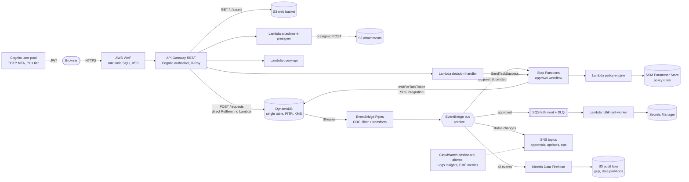

# Request Hub: a cloud-native request and approval platform on AWS

An industry-agnostic, event-driven platform for anything that needs a "yes" before it happens: purchases, access, leave, production changes, or a general request. Policy rules auto-approve low-risk requests, route the rest to the right approvers, escalate when an SLA is missed, and fulfil approved work automatically, with a full audit trail.

It is built to run inside the **KodeKloud AWS Playground** (3-hour sessions, us-east-1), so every design choice respects its limits. One command deploys it from AWS CloudShell.

## Architecture



### The flow, in one paragraph

A signed-in user submits a request. API Gateway validates the JSON against a schema and writes it **straight into DynamoDB** (no Lambda). DynamoDB Streams feeds **EventBridge Pipes**, which filters and reshapes the change into a clean `Request Submitted` domain event on a custom bus. That starts a **Step Functions** workflow: a small policy engine reads the rules from Parameter Store and decides the risk tier. Low risk is auto-approved. Otherwise the workflow uses the **AWS SDK integration with `.waitForTaskToken`** to store a task token on the request and pause. Approvers get an SNS email; when one decides in the web app, a Lambda checks they are allowed (right group, not their own request) and calls `SendTaskSuccess`. If nobody decides before the SLA, the workflow escalates to admins, then expires the request. Every status change is itself a DynamoDB write, so Pipes turns it into a `Request Status Changed` event that EventBridge routes to SNS (notifications), SQS (fulfilment) and Firehose (audit lake).

## AWS services used (24)

| Area | Services |
| --- | --- |
| Edge and identity | AWS WAF, Amazon API Gateway (REST), Amazon Cognito |
| Compute and orchestration | AWS Lambda (5 small functions), AWS Step Functions |
| Events and messaging | Amazon EventBridge (bus, rules, archive), EventBridge Pipes, Amazon SQS, Amazon SNS |
| Data | Amazon DynamoDB (Streams, PITR, GSIs), Amazon S3 (web, attachments, audit lake), Amazon Kinesis Data Firehose |
| Security and config | AWS KMS (customer managed key), AWS Secrets Manager, AWS Systems Manager Parameter Store, AWS IAM |
| Observability | Amazon CloudWatch (dashboard, alarms, Logs Insights, EMF metrics), AWS X-Ray |
| Delivery | AWS CloudFormation and AWS SAM, AWS CodePipeline (V2), AWS CodeBuild, AWS CloudShell |
| Governance (optional stack) | AWS CloudTrail, AWS Config managed rules |

## Designed around the playground limits

| Playground limit | How the design handles it |
| --- | --- |
| A Lambda function invoked more than 300 times in an hour is deleted | Lambda only where code adds value. Create, routing, notifications, fulfilment queueing and auditing are functionless. The smoke test watches DynamoDB directly instead of polling the API. A CloudWatch alarm fires at 200 invocations per function per hour. |
| Lambda max 256 MB and 10 s timeout | All functions use 256 MB and 8 s. Long waits live in Step Functions, not in Lambda. |
| No CloudFront | The single-page app is served over HTTPS by API Gateway from a private S3 bucket. Same origin as the API, so no CORS, and WAF protects the UI too. |
| App Runner closed to new customers (April 2026) | Not used. ECS Express Mode is the AWS successor if you want a container front end later. |
| Cognito pools need MFA, 12+ character passwords, advanced security | Plus tier, TOTP MFA required, strong password policy, user existence errors suppressed. |
| Step Functions must have logging | `ALL` level logging with execution data to an encrypted log group, plus X-Ray tracing. |
| Firehose buffer max 5 MB, interval min 60 s | 1 MB / 60 s buffering, no dynamic partitioning (it needs 64 MB buffers). Date partitions come from timestamp prefixes. |
| CodeBuild small compute, 10-minute builds, 3 pipelines, 5 runs per hour | Small compute, 10-minute timeout, one pipeline. `release.sh` refuses to start a 5th run in an hour. |
| Sessions last 3 hours, then the account is wiped | Everything is code. A fresh session goes from empty to working in one command. |
| IAM: inline role policies are denied, and roles can only be passed to services from the `/service-role/` path | Every role is explicit, lives under `/service-role/` and uses customer managed policies. No SAM-generated roles. |
| Tagging is denied for several services, and KMS rotation, log retention and some deletes are denied | No resource or stack tags (plain CloudFormation instead of SAM resources, which auto-tag). Keys, log groups and parameters are retained on delete and get per-stack unique names, so a redeploy never collides with leftovers. |
| AWS WAF and EventBridge Pipes are blocked by an organisation-level service control policy (found Nov 2026, even though the playground page lists WAF) | `deploy.sh` probes both before deploying. Without WAF, API Gateway throttling and schema validation remain at the edge. Without Pipes, a small batched Lambda publishes the same CDC events, so everything downstream is identical. In a normal account both are on by default. |

## Deploy (AWS CloudShell, us-east-1)

```bash
git clone https://github.com/bamboomaster112/aws-request-hub.git
cd aws-request-hub
./scripts/preflight.sh                 # read-only permission probe, about 20 seconds
./scripts/deploy.sh                    # core stack + web app + CI/CD stack
python3 scripts/seed-users.py          # requester, approver and admin test users with MFA enrolled
python3 scripts/smoke-test.py          # end-to-end checks
```

Options for `deploy.sh`:

| Variable | Default | Effect |
| --- | --- | --- |
| `NOTIFICATION_EMAIL` | empty | Subscribes an email address to the approvals, updates and ops topics |
| `USE_PIPES` | `true` | `false` swaps EventBridge Pipes for a small Lambda CDC publisher (switched automatically when Pipes is blocked) |
| `ENABLE_WAF` | `auto` | `true` / `false` forces the WAF web ACL on or off; `auto` turns it off when WAF is blocked |
| `SLA_SECONDS` | `180` | Approval and escalation timers (short for demos) |
| `WITH_PIPELINE` | `true` | Deploys the CodePipeline/CodeBuild stack |
| `WITH_GOVERNANCE` | `false` | Deploys CloudTrail and AWS Config rules |

To use the web app yourself, create a real user and follow the emailed temporary password:

```bash
./scripts/create-user.sh you@yourdomain.com approvers
```

## Demo script

1. **Auto-approval.** Raise a PURCHASE for 250. It moves from SUBMITTED to AUTO_APPROVED to FULFILLED (with a PO reference) in a few seconds, with no human involved.
2. **Human approval.** Raise a PURCHASE for 1,200. Open the Step Functions console: the execution is paused on `RequestApproval`. Approve it as an approver and watch the execution resume.
3. **Segregation of duties.** Try to approve your own request. The API refuses with 403.
4. **High risk.** Raise a CHANGE request. It routes to admins only.
5. **SLA escalation.** Leave an ACCESS request alone for 3 minutes. It escalates to admins, and an email goes out.
6. **Failure handling.** Raise a GENERAL request for 50 with `[fail]` in the title. Fulfilment fails three times, the message lands in the DLQ, and the DLQ alarm fires.
7. **Security at the edge.** Put `' UNION SELECT` in a title or `<script>` in a description. WAF answers 403.
8. **Audit lake.** A minute later, browse `s3://request-hub-audit-.../events/year=/month=/day=/`.
9. **Operations.** Open the `request-hub-operations` CloudWatch dashboard, including the Lambda budget widget against the 300 per hour line.

`python3 scripts/smoke-test.py --escalation --dlq --audit` runs all of these automatically.

## CI/CD

`./scripts/release.sh` zips the current commit into the pipeline's source bucket. S3 emits an `Object Created` event, an EventBridge rule starts **CodePipeline V2**, the **Test** stage runs unit tests, `cfn-lint`, Bandit SAST and a JavaScript syntax check, and the **Deploy** stage publishes the web app. Infrastructure changes stay with `deploy.sh`, which keeps every pipeline run well inside the 15-minute limit.

## Repository layout

```
template.yaml                      core stack, plain CloudFormation packaged by the SAM CLI (about 90 resources)
statemachine/approval-workflow.asl.json
src/<function>/app.py              policy_engine, query_api, decision_handler,
                                   attachment_presigner, fulfilment_worker, stream_publisher
web/                               single-page app (no framework, no build step)
pipeline/                          cicd.yaml + buildspecs
governance/governance.yaml         CloudTrail + AWS Config rules
scripts/                           preflight, deploy, publish-web, seed-users, smoke-test,
                                   create-user, release, teardown
tests/                             unit tests for handlers, policy and workflow definition
```

## Data model (single table)

| Item | PK | SK | GSI1 | GSI2 |
| --- | --- | --- | --- | --- |
| Request | `REQ#<id>` | `META` | `USER#<sub>` / createdAt | `STATUS#<status>` / createdAt |
| Attachment | `REQ#<id>` | `ATT#<attachmentId>` | | |

Rule that keeps the event stream clean: **every write to a META item is a status transition**. Attachments are child items, so uploading a file never re-sends an approval email.

## Teardown

```bash
./scripts/teardown.sh
```

The playground wipes the account when the session ends, but this is the habit to keep in a real account.

## Extension ideas

* Container front end on Amazon ECS Express Mode (the App Runner successor).
* Query the audit lake with Athena and a Glue table (not available in the playground).
* Amazon Bedrock to summarise long requests for approvers (not available in the playground).
* Multi-step approvals (manager, then finance) as a Map state over an approver chain.
* Replace email links with Slack approvals through Amazon Q Developer in chat applications.
